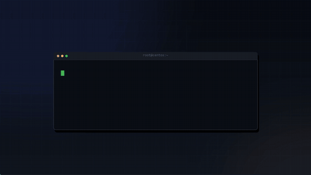

# 从 0 到实验报告：VMware 虚拟机接入 MCP 全流程

> 让 AI 直接操作你的虚拟机做实验、截页面、出报告。

**中文** | [English](README.en.md)

[](https://github.com/baizhan007/vmware-mcp-guide/actions/workflows/docs-check.yml)
[]()
[]()
[]()
[]()
[](LICENSE)

---

## 这份教程解决什么问题

传统做法是：人在 VMware 窗口里敲命令 → 截图 → 粘进 Word → 调格式。
一个大数据实验报告要折腾 4~6 小时，其中 70% 的时间花在**重复劳动**上。

这套方案把流程变成：

```
你说「做实验并出报告」
  → AI 通过 MCP 操作虚拟机（装环境、跑命令）
  → 自动截取 Web UI 页面
  → 自动生成带图排版的 docx
  → 你只需要看一眼、改改措辞
```

**核心收益**

- **真实可追溯** — 每条命令、每份输出都是真机跑的，不是编的
- **环境可复用** — 装一次，以后每次实验只需启停
- **坑已踩完** — [18 条踩坑清单](docs/08-pitfalls.md) 直接省你几小时
- **零依赖** — 服务器只用 Node 内置模块，clone 下来就能跑，不用 `npm install`

---

## 快速开始

只需要 **Node 18+** 和 **VMware Workstation 17.x**（Windows）。

```powershell
git clone https://github.com/baizhan007/vmware-mcp-guide.git
cd vmware-mcp-guide

# 1. 复制配置，改成你自己的 .vmx 路径（vmrunPath 留空会自动探测）
copy examples\config.example.json examples\config.json

# 2. 自检：Node / vmrun / 配置 / 虚拟机 / SSH 密钥，一条命令告诉你哪里没通
node scripts/doctor.mjs

# 3. 真实握手：启动 server，initialize + tools/list，校验 25 个工具的 schema
node scripts/smoke.mjs
```

看到 `smoke: ok` 就说明服务器本身没问题。接着把它注册进你的 MCP 客户端：

```yaml
# DSH: %USERPROFILE%\.dsh\profiles\desktop\cordis.patch.yml
- insert:
    - id: mcp-vmware
      name: "@deepseek-ai/dsh-mcp-client"
      config:
        serverName: vmware
        transport: stdio
        command: "C:\\Program Files\\nodejs\\node.exe"
        args: ["D:\\work\\vmware-mcp-guide\\examples\\server.js"]
        cwd: "D:\\work\\vmware-mcp-guide\\examples"
        failOnStartupError: true
        toolCallTimeoutMs: 120000
```

Claude Desktop / Cline / Cursor 的写法见 [第五章](docs/05-register.md)。

验证：

```
AI: 调用 list_vms

→ running VMs: 1
  CentOS 7 64 位  (D:\VMs\CentOS 7 64 位.vmx)
  aliases: centos -> D:\VMs\CentOS 7 64 位.vmx
```

成功。接下来看 [第三章](docs/03-channels.md) 把通道彻底打通。

> **只想最快跑起来？** 直接看 [第九章 最小可用清单](docs/09-minimal.md)。

---

## 目录

| 章节 | 内容 | 难度 |
|:---|:---|:---:|
| [第一章 整体架构](docs/01-architecture.md) | 数据怎么流动 | ⭐ |
| [第二章 宿主机准备](docs/02-host-prep.md) | VMware / Node / 虚拟机 | ⭐ |
| [第三章 打通通道](docs/03-channels.md) | **最关键的一章** | ⭐⭐⭐ |
| [第四章 编写 MCP 服务器](docs/04-mcp-server.md) | server.js + config.json | ⭐⭐⭐ |
| [第五章 注册 MCP](docs/05-register.md) | DSH / Claude Desktop / Cline / Cursor | ⭐⭐ |
| [第六章 做实验](docs/06-experiments.md) | 把命令封装成脚本 | ⭐⭐ |
| [第七章 出报告](docs/07-reports.md) | 截图与排版 | ⭐⭐ |
| [第八章 踩坑清单](docs/08-pitfalls.md) | **18 条实战教训** | ⭐ |
| [第九章 最小可用清单](docs/09-minimal.md) | 照抄即可 | ⭐ |

英文版正在逐章翻译，进度见 [`docs/en/`](docs/en/README.md)。

---

## 仓库结构

```
vmware-mcp-guide/
├── README.md                    # 你在这里
├── README.en.md                 # English
├── docs/
│   ├── 01-architecture.md       # 整体架构
│   ├── 02-host-prep.md          # 宿主机准备
│   ├── 03-channels.md           # 通道打通（重点）
│   ├── 04-mcp-server.md         # 编写 MCP 服务器
│   ├── 05-register.md           # 各客户端注册方式
│   ├── 06-experiments.md        # 实验脚本化
│   ├── 07-reports.md            # 截图与报告生成
│   ├── 08-pitfalls.md           # 踩坑清单
│   ├── 09-minimal.md            # 最小可用清单
│   └── en/                      # 英文版（翻译中）
├── examples/
│   ├── server.js                # MCP 服务器（25 工具，零依赖）
│   ├── config.example.json      # 配置模板（复制成 config.json）
│   ├── guest-sh.ps1             # SSH 脚本执行封装
│   ├── test-client.js           # 命令行测试客户端
│   ├── lab.ps1                  # 日常操作总入口
│   ├── report_builder.py        # 报告生成器
│   └── experiments/
│       └── hive-import.sh       # 示例实验脚本
├── scripts/
│   ├── doctor.mjs               # 环境自检
│   ├── smoke.mjs                # 真实握手测试（CI 跑这个）
│   └── check-links.mjs          # Markdown 相对链接检查
├── video/
│   ├── make_video.py            # 宣传视频生成器（纯代码逐帧绘制）
│   └── vmware-mcp-guide-promo.mp4
├── .github/workflows/
│   └── docs-check.yml           # CI：握手 / 语法 / 断链 / 敏感文件
└── assets/
    └── yarn-ui.png              # 效果截图
```

---

## 宣传视频

30 秒，1920×1080。**没有一帧是录屏** —— 全部由 `video/make_video.py` 用 Python + Pillow 逐帧绘制。



| 分镜 | 内容 |
|:---|:---|
| 0:00 – 0:05 | 痛点：一份实验报告 4~6 小时，70% 是重复劳动 |
| 0:05 – 0:11 | 思路：你 → MCP → server.js → 虚拟机 |
| 0:11 – 0:17 | 执行：真实命令逐字打出，MR 任务 SUCCESS |
| 0:17 – 0:23 | 产出：自动生成的报告 + 自动截取的页面 |
| 0:23 – 0:30 | 收尾：仓库地址 |

上面是 GIF 预览（640×360，1.3 MB）。**高清原片**（1080p / 完整动效）在这里：

▶ **[下载观看（1.25 MB）](https://github.com/baizhan007/vmware-mcp-guide/raw/main/video/vmware-mcp-guide-promo.mp4)**

> GitHub 的 README 不支持直接内嵌 mp4，所以高清版给的是下载链接。
> 想看在线播放版可以把 mp4 拖进 GitHub 的 Issue 输入框，它会生成一个可播放的 `user-attachments` 地址。

---

## 效果展示

用 headless 浏览器自动截取的 Hadoop YARN 页面：


自动生成的实验报告包含：真实命令输出、结果表格、Web UI 截图、排错记录。

---

## 核心设计取舍

| 决策 | 原因 |
|:---|:---|
| **SSH 为主通道** | 能拿到完整 stdout/stderr，MCP 的 `run_command_in_guest` 多命令只回最后一条 |
| **长任务写成 .sh 脚本** | MCP 单次调用默认 120 秒超时，装包跑 MR 必然超 |
| **截图用 headless 浏览器** | 1400×900 高清，可批量；VNC 只有 800×600 纯文本 |
| **Web UI 走 SSH 隧道** | 8088 只绑 127.0.0.1，9870/19888 被 firewalld 拦 |
| **报告用 JSON 配置驱动** | 内容与排版分离，改文字不用碰代码 |
| **手写 JSON-RPC，不用 SDK** | 零依赖、能看清协议原文、工具面小（25 个）成本低 |

---

## 已知限制

1. **只支持 Windows 上的 VMware Workstation** — 脚本是 PowerShell，路径按 Windows 习惯写的
2. **headless 浏览器需要 `danger-full-access`** — 它依赖命名管道 IPC，`workspace-write` 沙箱下会报 `platform_channel.cc:187 Check failed`
3. **虚拟机重启后 Hadoop 不会自启** — 需要重新执行启动脚本
4. **VNC 只有 800×600** — 控制台画面够用，不适合截 Web UI
5. **`vmrun typeKeystrokesInGuest` 在 Workstation 17.6.4 上不可用** — 详见 [第三章](docs/03-channels.md)

---

## 适用场景

- ✅ 大数据 / 数据库 / 操作系统课程实验
- ✅ 需要反复重建的环境验证
- ✅ 实验报告、验收文档自动生成
- ✅ 多人共享同一套虚拟机环境

- ❌ 需要图形界面操作的实验（虚拟机需装桌面，且 headless 截图不适用）
- ❌ 需要实时交互的调试（MCP 是请求-响应模型）

---

## 贡献

欢迎提 [Issue](https://github.com/baizhan007/vmware-mcp-guide/issues) 分享你踩到的坑。如果这份教程帮你省了时间，给个 Star ⭐。

提交前跑一下本地检查：

```powershell
node scripts/check-links.mjs     # 检查 Markdown 相对链接
node scripts/smoke.mjs           # 真实握手 + 工具 schema 校验
```

CI 会跑同样的检查，外加 PowerShell / Python / Shell 语法检查与敏感文件扫描（见 [.github/workflows/docs-check.yml](.github/workflows/docs-check.yml)）。

## License

[MIT](LICENSE)
