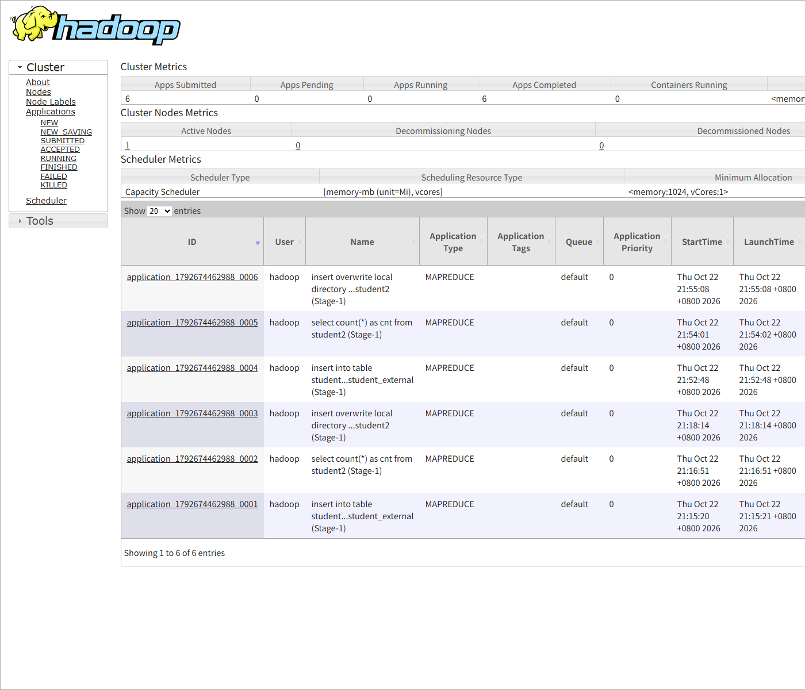

# 从 0 到实验报告：VMware 虚拟机接入 MCP 全流程
  ————（ps：culr应对clc老师）

> 让 AI 直接操作你的虚拟机做实验、截页面、出报告。

[](https://github.com/baizhan007/vmware-mcp-guide/actions/workflows/docs-check.yml)
[]()
[]()
[]()
[](LICENSE)

---

## 这份教程解决什么问题

传统做法是：人在 VMware 窗口里敲命令 → 截图 → 粘进 Word → 调格式。
一个大数据实验报告要折腾 4~6 小时，其中 70% 的时间花在**重复劳动**上。

这套方案把流程变成：

```
你说「做实验并出报告」
  → AI 通过 MCP 操作虚拟机（装环境、跑命令）
  → 自动截取 Web UI 页面
  → 自动生成带图排版的 docx
  → 你只需要看一眼、改改措辞
```

**核心收益**

- **真实可追溯** — 每条命令、每份输出都是真机跑的，不是编的
- **环境可复用** — 装一次，以后每次实验只需启停
- **坑已踩完** — [16 条踩坑清单](docs/08-pitfalls.md) 直接省你几小时

---

## 目录

| 章节 | 内容 | 难度 |
|:---|:---|:---:|
| [第一章 整体架构](docs/01-architecture.md) | 数据怎么流动 | ⭐ |
| [第二章 宿主机准备](docs/02-host-prep.md) | VMware / Node / 虚拟机 | ⭐ |
| [第三章 打通通道](docs/03-channels.md) | **最关键的一章** | ⭐⭐⭐ |
| [第四章 编写 MCP 服务器](docs/04-mcp-server.md) | server.js + config.json | ⭐⭐⭐ |
| [第五章 注册 MCP](docs/05-register.md) | DSH / Claude Desktop / Cline | ⭐⭐ |
| [第六章 做实验](docs/06-experiments.md) | 把命令封装成脚本 | ⭐⭐ |
| [第七章 出报告](docs/07-reports.md) | 截图与排版 | ⭐⭐ |
| [第八章 踩坑清单](docs/08-pitfalls.md) | **16 条实战教训** | ⭐ |
| [第九章 最小可用清单](docs/09-minimal.md) | 照抄即可 | ⭐ |

**只想快速上手？** 直接看 [第九章](docs/09-minimal.md)，四样东西就能跑起来。

---

## 快速开始

### 1. 确认环境

```powershell
# VMware Workstation 17.x
& "C:\Program Files (x86)\VMware\VMware Workstation\vmrun.exe" -T ws list

# Node 18+
node --version
```

### 2. 复制配置

```powershell
git clone https://github.com/baizhan007/vmware-mcp-guide.git
cd vmware-mcp-guide

npm install

# 复制配置模板并改成你自己的路径
copy examples\config.example.json examples\config.json
```

编辑 `examples\config.json`：

```json
{
  "vmrunPath": "C:\\Program Files (x86)\\VMware\\VMware Workstation\\vmrun.exe",
  "defaultVm": "centos",
  "vms": {
    "centos": "D:\\VMs\\CentOS 7 64 位.vmx"
  },
  "guestUser": "root",
  "guestPassword": "your-password"
}
```

### 3. 配 SSH 免密

```powershell
# 生成密钥（必须用 cmd，PowerShell 的 -N '""' 会变成字面量密码）
cmd.exe /c 'ssh-keygen.exe -t ed25519 -f "%USERPROFILE%\.ssh\vmware_centos" -N "" -C dsh-vmware-mcp'

# 把 %USERPROFILE%\.ssh\vmware_centos.pub 的内容追加到虚拟机 /root/.ssh/authorized_keys
```

### 4. 注册到 MCP 客户端

DSH 用户在 `%USERPROFILE%\.dsh\profiles\desktop\cordis.patch.yml` 追加：

```yaml
- insert:
    - id: mcp-vmware
      name: "@deepseek-ai/dsh-mcp-client"
      config:
        serverName: vmware
        transport: stdio
        command: "D:\\nodejs\\node.exe"
        args:
          - "D:\\path\\to\\vmware-mcp\\server.js"
        cwd: "D:\\path\\to\\vmware-mcp"
        failOnStartupError: true
        toolCallTimeoutMs: 120000
```

其他客户端见 [第五章](docs/05-register.md)。

### 5. 验证

```
AI: 调用 list_vms

→ running VMs: 1
  CentOS 7 64 位  (D:\VMs\CentOS 7 64 位.vmx)
  aliases: centos -> D:\VMs\CentOS 7 64 位.vmx
```

成功。接下来看 [第三章](docs/03-channels.md) 把通道彻底打通。

---

## 仓库结构

```
vmware-mcp-guide/
├── README.md                    # 你在这里
├── LICENSE
├── package.json                 # npm install 依赖
├── docs/
│   ├── 01-architecture.md       # 整体架构
│   ├── 02-host-prep.md          # 宿主机准备
│   ├── 03-channels.md           # 通道打通（重点）
│   ├── 04-mcp-server.md         # 编写 MCP 服务器
│   ├── 05-register.md           # 各客户端注册方式
│   ├── 06-experiments.md        # 实验脚本化
│   ├── 07-reports.md            # 截图与报告生成
│   ├── 08-pitfalls.md           # 踩坑清单
│   └── 09-minimal.md            # 最小可用清单
├── examples/
│   ├── config.example.json      # MCP 配置模板（复制成 config.json）
│   ├── server.js                # MCP 服务器完整实现
│   ├── guest-sh.ps1             # SSH 脚本执行封装
│   ├── test-client.js           # 命令行测试工具
│   ├── lab.ps1                  # 日常操作总入口
│   ├── report_builder.py        # 报告生成器
│   └── experiments/
│       └── hive-import.sh       # 示例实验脚本
├── scripts/
│   └── check-links.mjs          # Markdown 相对链接检查
├── .github/workflows/
│   └── docs-check.yml           # CI：断链 / 语法 / 敏感文件检查
└── assets/
    └── yarn-ui.png              # 效果截图
```

---

## 效果展示

用 headless 浏览器自动截取的 Hadoop YARN 页面：



自动生成的实验报告包含：真实命令输出、结果表格、Web UI 截图、排错记录。

---

## 核心设计取舍

| 决策 | 原因 |
|:---|:---|
| **SSH 为主通道** | 能拿到完整 stdout/stderr，MCP 的 `run_command_in_guest` 多命令只回最后一条 |
| **长任务写成 .sh 脚本** | MCP 单次调用默认 120 秒超时，装包跑 MR 必然超 |
| **截图用 headless 浏览器** | 1400×900 高清，可批量；VNC 只有 800×600 纯文本 |
| **Web UI 走 SSH 隧道** | 8088 只绑 127.0.0.1，9870/19888 被 firewalld 拦 |
| **报告用 JSON 配置驱动** | 内容与排版分离，改文字不用碰代码 |

---

## 已知限制

1. **headless 浏览器需要 `danger-full-access`** — 它依赖命名管道 IPC，`workspace-write` 沙箱下会报 `platform_channel.cc:187 Check failed`
2. **虚拟机重启后 Hadoop 不会自启** — 需要重新执行启动脚本
3. **VNC 只有 800×600** — 控制台画面够用，不适合截 Web UI
4. **`vmrun typeKeystrokesInGuest` 在 Workstation 17.6.4 上不可用** — 详见 [第三章](docs/03-channels.md)

---

## 适用场景

- ✅ 大数据 / 数据库 / 操作系统课程实验
- ✅ 需要反复重建的环境验证
- ✅ 实验报告、验收文档自动生成
- ✅ 多人共享同一套虚拟机环境

- ❌ 需要图形界面操作的实验（虚拟机需装桌面，且 headless 截图不适用）
- ❌ 需要实时交互的调试（MCP 是请求-响应模型）

---

## 贡献

欢迎提 [Issue](https://github.com/baizhan007/vmware-mcp-guide/issues) 分享你踩到的坑。如果这份教程帮你省了时间，给个 Star ⭐。

提交前跑一下本地检查：

```powershell
npm install
node scripts/check-links.mjs     # 检查 Markdown 相对链接
```

CI 会自动跑断链检查、脚本语法检查、敏感文件扫描（见 `.github/workflows/docs-check.yml`）。

## License

[MIT](LICENSE)
